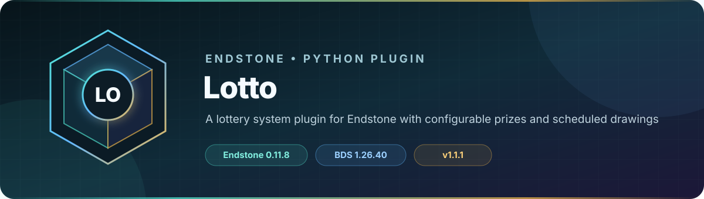

<!-- endstone-professional-header:start -->
<p align="center">
  
</p>

<p align="center">
  <a href="https://github.com/TheNINJALLO/endstone-lotto/actions/workflows/wheel-release.yml"></a>
  <a href="https://github.com/TheNINJALLO/endstone-lotto/releases/latest"></a>
</p>

<p align="center">
  
  
  
  =3.10" src="https://img.shields.io/badge/Python-%3E=3.10-3776AB?style=flat-square&amp;logo=python&amp;logoColor=white">
</p>

<p align="center">
  <strong>A lottery system plugin for Endstone with configurable prizes and scheduled drawings.</strong>
</p>

<p align="center">
  <a href="#what-it-does">What it does</a> &bull;
  <a href="#how-to-use">How to use</a> &bull;
  <a href="#commands-and-permissions">Commands</a> &bull;
  <a href="#install">Install</a> &bull;
  <a href="https://github.com/TheNINJALLO/endstone-lotto/releases">Releases</a>
</p>

## Overview

A lottery system plugin for Endstone with configurable prizes and scheduled drawings. This release is aligned with Endstone 0.11.8 and Minecraft Bedrock Dedicated Server 1.26.40, and is distributed as a Python wheel for direct installation in an Endstone server.

## What it does

- Runs multiple scheduled lotteries with configurable entry prices, prize values, and draw intervals.
- Charges and pays players through the `Money` scoreboard and queues rewards for offline winners.
- Uses a configured interaction block for player ticket purchases and an operator form for administration.

## How to use

1. Verify the `Money` scoreboard objective, run `/lotto`, and create at least one lottery type.
2. Set the player interaction block in the generated configuration and place that block where players can reach it.
3. Players right-click the configured block to buy entries; scheduled draws and offline payout delivery are automatic.
4. Run `/lottoreload` after editing `config.json` directly.

## Commands and permissions

| Command / usage | What it does | Access |
|---|---|---|
| `/lotto` | Open the lottery admin menu | `lotto.admin` |
| `/lottoreload` | Reload the lotto configuration | `lotto.admin` |

## Compatibility

| Component | Supported version |
|---|---|
| Endstone | `0.11.8` |
| Endstone API | `0.11` |
| Bedrock Dedicated Server | `1.26.40` |
| Python | `>=3.10` |
| Plugin release | `v1.1.1` |

## Install

Download the wheel from the matching GitHub release:

```bash
gh release download v1.1.1 --repo TheNINJALLO/endstone-lotto --pattern "*.whl"
```

Copy the downloaded wheel into the server's `plugins/` directory, remove any older wheel for the same plugin, and restart Endstone.

> [!IMPORTANT]
> Use Endstone `0.11.8` with BDS `1.26.40`. Back up worlds and plugin data before upgrading a production server.

## Configuration and secrets

Runtime databases, logs, local `.env` files, server directories, and root `config.toml` files are excluded from source releases. When an example configuration is provided, copy it locally and keep live tokens, passwords, webhook URLs, and server identifiers out of Git.

## Release automation

Every `v*` tag runs [the wheel release workflow](.github/workflows/wheel-release.yml), builds the package in a clean GitHub runner, stores the wheel as a workflow artifact, and attaches it to the matching GitHub release.
<!-- endstone-professional-header:end -->

---

## Project guide

A lottery system plugin for Endstone with configurable prizes and scheduled drawings.

Requires Endstone 0.11.8 or newer in the 0.11 series (BDS 1.26.40).

## Features

- Multiple configurable lottery types with custom prizes and entry costs
- Scheduled automatic draws
- Player entry purchases using scoreboard-based money
- Offline reward delivery upon login
- Verified scoreboard payouts with automatic retry when a payout fails
- Admin interface for managing lotteries

## Configuration

Configure lotteries through the in-game admin menu (`/lotto` command) or by editing the `config.json` in the plugin data folder.
